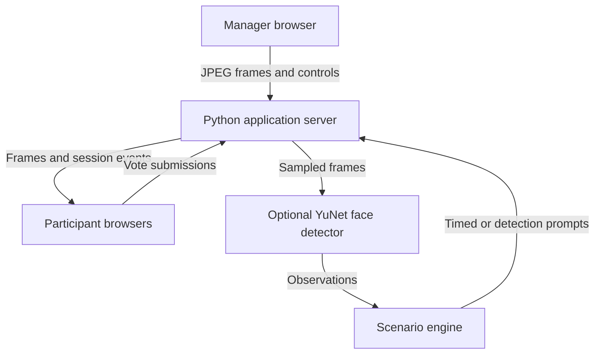

# Surveillance Lab

A complete, locally runnable multiplayer web application for a facilitated mass-surveillance presentation. A manager broadcasts a shared scene; participants join with a room code, answer timed scenarios, and compare their decisions after a reveal.

## What is included

- Responsive manager and participant interfaces, with no frontend build step or external web assets.
- Room creation, six-character join codes, nickname entry, per-tab credential recovery, and connection recovery.
- Browser camera capture and a shared JPEG frame feed (approximately 3–4 frames/second, no audio).
- An animated demo scene with explicitly labeled synthetic people and synthetic detections.
- Optional real, offline **OpenCV YuNet face detection**, with face bounding boxes, counts, and detection scores.
- Manual scenarios, periodic prompts, detection-triggered prompts, custom scenarios, timed voting, manager-only live counts, public reveals, and results history.
- A launchable 3×3 photo CAPTCHA demonstrating human image annotation, with per-tile selection rates and a discussion reveal.
- JSON exports containing aggregate results, scenario definitions, and the activity log. Credentials and image frames are excluded.
- Server-authoritative voting deadlines and permissions; participants cannot control the camera, trigger rounds, or read unrevealed results through the API.
- Automated server tests and a separate browser smoke test.

## CAPTCHA minigame

In the manager's **Introduce a decision** library, launch **Prove you are human**. Everyone receives the same nine-tile cat photograph. Participants select every square containing any part of the cat, then press **Verify**. They can update their submission until the round closes (at least 60 seconds). Empty selections are valid; each submission represents nine binary tile labels.

The manager sees live selection rates and can click **Reveal the training labels** to show the group how their selections form annotations. Percentages represent human selections, not model confidence or a scored answer key. Counts are per tile, so percentages across tiles need not sum to 100%. The reveal and aggregate labels are included in the existing history and JSON export. This is an educational simulation; no model is trained or external labeling service contacted.

## Requirements

- Python **3.10 or newer** with pip and venv.
- A modern browser. Chrome or Edge is recommended for the camera host.
- A webcam for live capture; no webcam is required for demo mode.
- Internet is needed to install dependencies. After installation, the application and its optional detector run without external network requests.

## Quick start: macOS / Linux

Unzip the project, open a terminal in the `surveillance-lab` folder, and run:

```bash
python3 -m venv .venv
source .venv/bin/activate
python -m pip install -r requirements.txt
python server.py
```

Open **http://localhost:8000**. Keep the terminal open while using the app. Press **Ctrl+C** in the terminal to stop it.

If Python reports that venv is unavailable on Linux, install your distribution’s Python venv package before continuing.

## Quick start: Windows PowerShell

Open PowerShell in the extracted `surveillance-lab` folder:

```powershell
py -m venv .venv
.\.venv\Scripts\python.exe -m pip install -r requirements.txt
.\.venv\Scripts\python.exe server.py
```

Presentation run:
  Use 0.0.0.0 IP address on host computer to bypass ssl certificate requirement for the approaching computers

Open **http://localhost:8000**. These commands do not require changing PowerShell’s script execution policy.

## Try the whole experience in five minutes

1. In your main browser, create a session. You are now the manager. The browser asks for camera permission and broadcasts this device’s default camera when allowed. If access fails, the room stays open; allow access and click **Share camera** to retry.
2. Click **Start demo scene**. You should see the synthetic shared scene and simulated person boxes.
3. Open an **incognito/private window** or a separate browser. Go to `http://localhost:8000`, enter the room code and a nickname, accept the session notice, and join.
4. As manager, launch **A presence becomes an alert**.
5. As participant, choose a response. Only the manager sees live group counts.
6. Click **Reveal results** as manager. Everyone sees the distribution and discussion prompt.
7. Try **Periodic prompts**, set an interval of 15 seconds and voting time of 10 seconds, then click **Apply settings**. The app cycles through timer scenarios; voting closes at the deadline, results reveal four seconds later, and the next prompt follows after the configured interval.
8. Try **Detection prompts** in demo mode. Two consecutive synthetic observations containing people can start a relevant scenario. The people slider changes the synthetic count. These are explicitly simulated detections, not model output.
9. Add a **Custom** scenario, export results, or end the session when finished.

Use a separate browser or private window for the participant during testing. Credentials are stored per browser tab; duplicated tabs can inherit a tab’s existing role.

## Enable the real vision model

Stop the server, install the vision requirements into the same virtual environment, and restart:

```bash
python -m pip install -r requirements-vision.txt
python server.py --vision
```

On Windows, substitute `.\.venv\Scripts\python.exe` for `python` if you have not activated the environment.

With the project environment installed, Windows users can also run `powershell -ExecutionPolicy Bypass -File .\start-vision.ps1`. This starts both the HTTP setup page and HTTPS camera app with the face detector enabled. Stop an existing server on ports 8000/8443 first, or choose separate ports with `-Port 8444 -SetupPort 8001`. The launcher uses the project environment so it loads the installed vision packages.

1. Open the manager at `http://localhost:8000` and create a session.
2. Click **Share camera** and allow camera access.
3. The detector analyzes a frame about every 0.5 seconds, subject to processing time. Everyone receives the same model observations and broadcast frames.
4. Enable **Detection prompts** and apply settings if you want detections to start scenarios.

### What this model can and cannot do

YuNet is a pretrained face detector run locally through OpenCV. Its ONNX weights and MIT license are bundled in `models/`; no API key, cloud upload, or runtime model download is needed. It is intended for close-up camera views, including seated participants. Poor lighting, profiles, occlusion, and very small faces can still cause misses or false detections.

The live feed displays **FACE** boxes with model detection scores and a face count. These scores are not identity confidence. The app does not recognize identities, infer emotion or intent, or determine whether anyone is suspicious. The scripted panic accusations remain a manually triggered demonstration.

The animated demo still uses synthetic people and is labeled accordingly. It does not run through YuNet.

### Detection trigger rules

- Two successive observations containing at least one face (or simulated person in demo mode) are required.
- A live feed is required. Stale frames cannot start a round.
- Three or more detections select a matching crowd scenario, if one exists.
- Otherwise a box centered in the observation zone selects a matching zone scenario, if one exists.
- Otherwise a matching face scenario (person scenario in demo mode) is selected, if one exists. The two investment scenarios remain timer/manual scenarios and are not triggered by faces.
- The configured interval is also the minimum cooldown between detection-triggered rounds.
- An open or closed-but-unrevealed round blocks all new rounds.
- Without periodic mode, the manager must reveal each round to allow the next detection-triggered round.

The observation zone is an illustrative boundary. It is not a claim that the physical space is restricted.

## Let people join from phones or other computers

1. Put the server computer and participant devices on the **same Wi-Fi or LAN**.
2. Find the computer’s LAN IPv4 address: Windows `ipconfig`, macOS Network settings, or Linux `hostname -I`.
3. Participants visit, for example, **http://192.168.1.20:8000**, and enter your room code. Substitute your real address.
4. Allow inbound TCP port 8000 through the computer’s firewall on your trusted network if necessary. Guest Wi-Fi with device isolation may block access.
5. Keep the **manager** open on the device whose camera you want to broadcast. Use a trusted **HTTPS** address on phones or other computers; **http://localhost:8000** also works when the manager is on the server computer.

A copied join link uses the manager’s current address. A link containing `localhost` works only on that same computer; replace `localhost` with the LAN address before sending it to phones. There is no QR generator in this version; room codes and copyable join links are provided.

Participants do not need camera permissions: they only receive the shared feed. Camera capture runs in the room creator’s browser on their current device, independently of where the Python server runs. It uses the browser’s default camera without forcing a rear camera, and captures no audio. Camera capture from a separate manager device normally requires **HTTPS**, because plain HTTP LAN addresses are not secure browser contexts.

## HTTPS and remote use

### iPhone camera on local Wi-Fi (Windows)

Run the local HTTPS launcher from the project folder:

```powershell
python local_https.py
```

It uses OpenSSL from PATH or the copy included with Git for Windows. It prints
the HTTP website link (port 8000) and an HTTPS app link (port 8443). Open the HTTP
website in **Safari on your iPhone**, with both devices on the same Wi-Fi. The
side links **Download certificate** and **Camera / HTTPS setup** are available
without joining a room:

1. Select **Download certificate**. The **Camera / HTTPS setup** page has installation instructions and a link to the HTTPS site.
2. In **Settings > General > VPN & Device Management**, select the downloaded profile and install it.
3. In **Settings > General > About > Certificate Trust Settings**, enable full trust for **Surveillance Lab Local CA**.
4. Open the HTTPS app link in Safari, **create the room on the iPhone**, and allow camera access. If the room is already open there, tap **Share camera**.

The launcher serves the same app and rooms over HTTP and HTTPS. Stop any existing
`server.py` process using port 8000 before launching it; rooms from an earlier
process are not transferred. Use HTTPS before creating or joining your room,
because browser credentials are stored separately for each address. Each device
must trust the local certificate to use HTTPS. Keep the terminal open. Ctrl+C
stops both listeners.

If automatic IP detection picks the wrong adapter, specify your computer's Wi-Fi
IPv4 address, for example `python local_https.py --ip 192.168.1.20`. Add `--vision`
to enable the optional detector. If the phone cannot load the setup page, allow
inbound TCP ports **8000 and 8443** through Windows Firewall for your trusted
network. University or guest Wi-Fi may block connections between devices; use
a network that allows them.

The local CA stays in `.local-https/`, which is ignored by Git. Only its public
certificate is downloadable. Keep the private keys private. The launcher issues
a fresh 90-day server certificate at startup and reuses the CA, so a changed
Wi-Fi IP does not require reinstalling the CA. Install only your own generated
CA; remove its profile from the iPhone when you no longer need it. Apple's
[certificate trust instructions](https://support.apple.com/en-us/102390) explain
the manual trust step.

### Hosted HTTPS or an existing certificate

For a remote manager, use a trusted HTTPS endpoint. You can terminate TLS at a reverse proxy or supply a trusted certificate directly:

```bash
python server.py --vision --cert /path/to/cert.pem --key /path/to/key.pem
```

The certificate must be trusted by the manager’s browser. With a reverse proxy, forward the original host, disable buffering on `/api/rooms/*/events`, and allow long-lived event-stream connections. Keep all participants on the same public hostname. This archive is source code for running your own server; it is not an already hosted public site.

To restrict who can create rooms, set `APP_PASSWORD` before starting the server:

```bash
# macOS / Linux
export APP_PASSWORD='choose-a-long-password'
python server.py
```

```powershell
# Windows PowerShell
$env:APP_PASSWORD = 'choose-a-long-password'
.\.venv\Scripts\python.exe server.py
```

Enter this value in the session-creation password field. Participants still join with a room code. This is a facilitated prototype: public hosting would need deployment-specific access controls, rate limiting, monitoring, and a scaling plan.

## Important behavior and limits

- **No video recording:** the server holds only the latest JPEG in RAM. Stopping or ending the broadcast clears it; a stalled broadcast is cleared after three seconds. This does not prevent participants from taking screenshots.
- **Temporary sessions:** room settings, custom scenarios, votes, and history live in RAM. They disappear when the server restarts. Rooms expire six hours after creation. Export results before restarting if you want to keep them.
- **One process:** run one server process. Multiple independent worker processes do not share room state.
- **Capacity:** the app enforces 50 rooms and 100 participant credentials per room. These are guardrails, not a verified performance guarantee. Start with a small group and test your intended audience size on the actual network.
- **Frame streaming:** the server relays small JPEG snapshots, not a full-framerate WebRTC video stream. Network load grows with each participant. There is no audio, RTSP camera integration, or recording upload in this version.
- **Approximate alignment:** observations carry frame sequence IDs and timestamps. Boxes from a recent analyzed frame appear over the current stream; they are not guaranteed to align with moving people on a later frame. Observations older than three seconds are hidden. Scenario trigger context is saved, but no frozen evidence image is retained.
- **Camera host:** the manager’s browser must remain open and active. Refreshing restores the dashboard credential; click Share camera again to resume capture. Mobile and background-tab throttling can interrupt the broadcast.
- **Voting:** one saved choice per participant credential per round. A choice can be changed before the deadline. Nicknames and credentials are not verified human identities; this is not election software.
- **Exports:** include aggregate revealed results, scenario content, and event metadata, without per-person votes, credentials, or images. Export is available to the manager only.
- **Automatic mode:** timer prompts begin after the selected interval. Detection prompts may begin earlier if enabled and eligible. A pending round blocks both. A manually closed round reveals after four seconds when automatic mode is enabled.

## Customize the experience

Edit `scenarios.json` before starting the server to change the built-in wording. Each scenario needs `id`, `title`, `category`, `trigger`, `observation`, `question`, `options`, and `reveal`. Keep the built-in `person`, `crowd`, `zone`, and at least one `timer` trigger if detection or automatic mode will be used. The manager’s Custom form creates session-only scenarios.

- `public/style.css`: colors, spacing, and responsive layout.
- `public/app.js`: browser rendering, camera capture, frame reception, and controls.
- `vision.py`: replaceable detector, returning normalized face boxes and detection scores.
- `server.py`: permissions, session state, prompts, streaming, voting, and exports.

## Tests

The server suite uses Python’s built-in unittest runner:

```bash
python -m unittest discover -s tests -v
```

Camera lifecycle checks use Node.js’s built-in test runner, with no additional packages:

```bash
node --test tests/camera.test.cjs
```

The optional browser smoke test needs Playwright and Chromium:

```bash
python -m pip install playwright
python -m playwright install chromium
python tests/browser_smoke.py
```

The script uses Playwright’s installed Chromium by default, or an executable supplied through `CHROMIUM_PATH`. It starts and stops an isolated server on port 8765, uses a fake camera, and exercises create/join, demo broadcast, hidden counts, voting, reveal, credential restoration, live capture, stopping, custom scenarios, reconnect, and session ending. Screenshots are written to a temporary directory for local inspection.

See `VALIDATION.md` for the checks actually completed when this archive was created.

## Architecture



The browser UI uses ordinary HTML, CSS, and JavaScript. The server uses aiohttp for HTTP and authenticated Server-Sent Events; video frames travel separately. The server owns voting deadlines and role authorization. No database or frontend build tooling is required.

## Panic simulation

Use **Start panic simulation** in the manager workspace to send a scripted AI failure alert to every connected screen. The emergency banner includes the supplied accusations, explicitly marked as false claims for the demonstration. The page, camera frame, and metrics switch to an emergency red theme without flashing.

The supplied `mixkit-classic-alarm-995.wav` recording loops at its original volume on devices where browser audio has been enabled by an interaction. If a browser blocks playback (including after restoring a session), click **Enable alarm sound** on that device. **Mute alarm on this device** affects only that browser. **Stop simulation for everyone** clears the shared alert and stops the sound; ending the session also clears it. Hidden tabs silence their audio until shown again.

Panic mode can interrupt an existing round. Its voting deadline continues, while new manual, periodic, and detection-triggered rounds are blocked until the manager stops the simulation.

Run the camera and alarm lifecycle checks with `node --test tests/camera.test.cjs tests/panic.test.cjs`.
